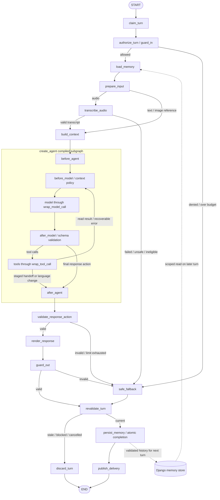

# Tchek-Am conversational agent: plan

Status: **Implementation in progress, 24 November 2026.** Core graph, middleware, durable execution, scoped memory, rendering/tools and local Langfuse validation are implemented. Owner-authorized synthetic live DeepSeek trials have run within the $1 ceiling; production rollout remains disabled. See [implementation ledger](ISSUES.md) and [capability evidence](CAPABILITIES.md) for results, limitations and remaining acceptance work; this is not a claim that A0–A9 have passed. The current scope and actual remaining blockers are listed in [readiness](READINESS.md); resolved owner decisions do not require another approval.

Builds on: docs/prd.md (R1–R8), docs/architecture.md, ADR-014 (messaging), ADR-016 (AI module), ADR-017 (report flow processing), ADR-013/022 (retention).
Replaces or amends through new ADRs: ADR-016 (Claude-only access), and ADR-008 if OpenRouter STT is selected. Accepted ADRs are not edited in place. ADR-001's Procrastinate queue remains in use. See §3.

---

## 1. Goal

Today the bot is a menu and keyword router (`conversations/router.py`) with one-shot AI calls for extraction and message flags. The goal is a **conversational agent**: a user can write freely in FR / EN / Pidgin ("est-ce que ce numéro est safe?", "I don the send money, wetin I go do?"), send a photo or voice note, ask follow-ups, and the agent picks tools, chains them, and answers in the user's language.

What must not change: the trust-and-safety rules. The agent is the **conversation layer**; the reputation engine, the verdict wording and the report/consent flow remain deterministic code. The model never decides what colour a number is, and never writes the verdict text.

Out of scope: moderator-facing AI, automatic report approval, group-listening changes (ADR-019), anything that lets the model write to reputation data.

## 2. Design principles

1. **The model chooses tools; code owns outcomes.** Verdicts, bands, consent, submission and appeals are produced by existing code and returned by tools as finished, translated text.
2. **Code renders the final answer.** The model selects a structured response action referencing successful tool results. Code sends the existing verdict text verbatim and renders advice, questions and confirmations from reviewed catalogs. There is no unrestricted model-authored follow-up after a verdict. A keyword filter cannot guarantee that free text contains no invented verdict.
3. **Deterministic priority, explicit agent entry points.** Commands, data-protection requests (STOP GROUP, STOP TRAINING), onboarding, blocked-user rules and active flows stay first. For an enabled cohort, eligible idle text, images with captions, voice notes and follow-ups enter the agent before the old idle media/number branches consume them. Bare numbers, contact cards and explicit menu choices can retain their existing deterministic shortcuts. The exact routing matrix is in §4.1.
4. **Degrade safely.** Model or OpenRouter failure produces a reviewed fallback without initiating another paid AI path. Langfuse failure disables tracing and never blocks the reply or changes the user's experience. Safety-policy, authorization or budget failures deny execution; they do not silently weaken a control.
5. **Everything behind adapters, no network in tests.** Same rule as ISSUES.md: `Fake*` implementations, no test makes a network call.
6. **Untrusted input everywhere.** Forwarded scam messages, screenshots and voice transcripts are attacker-controlled. Tools must be safe even if the model is fully compromised.
7. **Memory is scoped data, never authority.** Every turn has a server-assigned role, source and conversation generation. History can support follow-ups; it cannot grant permissions, confirm consent or authorize replay of an old tool call.
8. **Privacy and spending limits survive every retry.** Child model calls, STT, vision, fallbacks and web search use the same policy and reservation services. Optional classifiers also consume budget.

## 3. Decisions to record (draft ADRs)

### ADR-023 (draft): AI provider access through OpenRouter

**Question:** Do we keep Anthropic as the only provider (ADR-016), or route through OpenRouter?

**Owner update, 25 November 2026 (ADR-026):** OpenRouter now supplies every AI flow: agent chat/vision, report extraction, group-photo classification, message flags and transcription. Keep `LLMClient` and `SpeechToText` interfaces, with OpenRouter implementations and fakes only. Direct Anthropic/Groq adapters and keys are removed. Preserve SerpAPI independently.

Use `langchain-openrouter` (`ChatOpenRouter`) for LangChain chat/vision calls. The current integration exposes provider preferences through `openrouter_provider`; verify serialization against the pinned package. Use the STT endpoint through its own adapter, not an assumed chat-model API. Set explicit connect/read/total deadlines, bounded retries and usage collection in every adapter. Avoid unsupported claims about another client's default timeouts.

**Privacy contract:**
- Chat/vision inference requests carry the nested `provider` preferences `data_collection: "deny"`, `zdr: true`, `require_parameters: true`, and `only` for approved serving providers/endpoints. Use exact endpoint slugs where the reviewed policy requires them. A preferred `order` alone is not an allow-list. Model and provider fallback lists are separate and both constrained.
- Require account/application-key **ZDR only** settings, excluding Safety Retention across model groups. OpenRouter documents that request-level `zdr: true` can otherwise allow Safety Retention. A0 records and tests the effective configuration. [OpenRouter policy](https://openrouter.ai/docs/guides/features/zdr)
- OpenRouter documents Google Vertex Safety Retention and a BYOK option requiring an actual ZDR agreement. **Gemini remains conditional.** Prefer an eligible alternative if necessary; existing internal-match/SerpAPI reuse checks remain available. Screenshot OCR/payment extraction stays off until an eligible vision model passes. No implied authorization to relax privacy. [Google/BYOK details](https://openrouter.ai/docs/guides/features/zdr#google-safety-retention)
- Record OpenRouter's safety/legal exceptions in the access decision and notice. Inference ZDR does not govern tool backends or observability. Disable OpenRouter input/output logging, Broadcast exports and provider-hosted search/fetch plugins for this integration.
- STT uses its independently documented `provider.zdr: true` and `data_collection: deny` controls. Endpoint `only/order/ignore` preferences are unsupported for transcription and are not claimed. ADR-026 replaces the earlier STT endpoint-list requirement with this data-policy routing under owner-confirmed account ZDR. No hidden direct-provider fallback is permitted.

**Role-specific capability matrix:**

| Role | Configuration | Required capabilities and evaluation |
|---|---|---|
| Chat | `AGENT_CHAT_MODEL` | Owner-selected `deepseek/deepseek-v4.1-flash-1017` for client tools, validated actions and multilingual dialogue. |
| Vision | `AGENT_VISION_MODEL` | The same owner-selected DeepSeek model for image understanding and structured classification/extraction. MAI image generation is omitted. |
| STT | existing `SPEECH_BACKEND` / `SPEECH_MODEL`, with new `openrouter` backend | Actual WhatsApp OGG/Opus transcription, bounded audio duration/bytes, FR/EN/PCM/Camfranglais, critical number/amount accuracy and privacy controls. No chat tools or image support required. |

Each enabled role has an ordered model allow-list and an approved endpoint list. A role can use the same underlying model as another role if its own tests pass. Reject unsupported parameters rather than silently dropping them. Log served model, serving endpoint when available, request id, policy/prompt version, usage and outcome as metadata; refuse extraction on refusal, invalid output or truncation.

Owner update, 24 November 2026: keep the conversational agent and use DeepSeek for both chat and image classification. Remove the separate fast-classification role and omit MAI image generation. The UI mention was a mistake; no new UI is requested. The 25 November consolidation also removes the separate fast model globally; every report/group/message classifier now uses `OPENROUTER_MODEL`.

Import boundaries remain explicit: `ai/agent/models.py` and `ai/openrouter_client.py` own the LangChain/OpenRouter inference integration; `speech/openrouter.py` owns STT transport; the removed direct-provider adapters have no exceptions. No SDK imports elsewhere. A source-scan test checks the enumerated allow-list, including `langchain_openrouter`, `langchain_openai`, `anthropic` and `openai`.

**D1, models and initial serving endpoint selected; OpenRouter STT implemented.** Use `deepseek/deepseek-v4.1-flash-1017` for both chat and image classification. No separate fast role or MAI generation model is required. Initial synthetic trials use `together/us`; the owner confirmed account ZDR. A0 records endpoint/privacy capabilities and measurements for this selection. Report/group/message paths now use the same DeepSeek model through OpenRouter. `SPEECH_MODEL=openai/whisper-large-v3` is the default transcription model. A8 expands the same harness into release evaluation, including real audio accuracy.

### ADR-024 (draft): Conversational agent architecture

**Decision for this plan:** A compiled LangGraph `StateGraph`, embedded in Django/Procrastinate, with persistent conversation memory, explicit conditional edges, an agent tool loop and mandatory enforcement middleware. The design follows supported LangChain/LangGraph primitives; OWASP supplies security requirements rather than a drop-in agent framework or certification.

**Template and development:** The current `langchain-ai/new-langgraph-project` template is a single-node fixed-response graph, not a chatbot with memory ([source](https://github.com/langchain-ai/new-langgraph-project/blob/main/src/agent/graph.py)). Scaffold once in a scratch folder, pin the source revision, and use its graph/config conventions. Implement the complete graph in §4 rather than treating the scaffold as the finished agent. Use a `TypedDict`-based agent state compatible with LangChain v1 `create_agent`, a separate trusted runtime context, and a `langgraph.json` graph export. Studio runs locally against fakes/synthetic fixtures, without production keys, production data or enabled LangSmith tracing.

The inner agent is compiled by `langchain.agents.create_agent`, the supported replacement for `langgraph.prebuilt.create_react_agent`. It supplies the model/tools conditional loop. The outer graph supplies intake, memory reads/writes, media processing, final rendering, stale-run checks and durable completion. Export both the outer graph and an expanded view including the inner loop and middleware for review.

**Why Procrastinate instead of Celery:** ADR-001 selected a Postgres-backed queue to keep one database and reduce infrastructure for the current team. `core.tasks.register/enqueue` already provides task registration, scheduling, queue selection, worker locks and eager test execution; inbound processing, retention and outbound safeguards use it. Neither LangGraph nor middleware requires Celery. Retain Procrastinate and add a dedicated `agent` queue so inference cannot exhaust all messaging workers. Consider a separate worker and later Celery/broker migration only on measured queue latency, database load or deployment requirements; a broker migration is not part of this feature. Verify lifecycle/flush integration against Procrastinate, never Celery signals.

**D2, memory persistence: Django tables for the MVP.** `AgentRun` owns durable turn execution metadata; `AgentTurn` owns validated history; a scoped entity-reference table supports follow-ups without persisting raw tool payloads. Explicit `load_memory` and `persist_memory` graph nodes read/write these tables. This is a graph with memory even without a LangGraph checkpointer. New migrations, retention rules, erasure and legal-hold tests are required; none are inherited automatically from the existing models.

In-process state carries one bounded run. A worker crash restarts an unfinished run from durable turn state, revalidating all actions and idempotency keys; it does not resume an arbitrary node. `PostgresSaver` is deferred until per-node recovery or LangGraph interrupts are required. If adopted, it needs its own schema lifecycle, restricted serialization, access checks, deletion/hold rules and recovery tests. Existing deterministic consent flows provide human confirmation without a graph interrupt; no fake `HumanInTheLoopMiddleware` configuration is claimed.

## 4. Graph

### 4.1 Router entry points

Agent-off behavior stays exactly as today. When enabled, the cohort and supported-language checks occur after global commands/onboarding/active-flow routing, but before the old idle image, audio and embedded-number shortcuts.

| Input/state | Route |
|---|---|
| STOP GROUP / STOP TRAINING, including blocked or unonboarded users | Existing data-protection handler; invalidate pending agent work before it can act on old context. |
| Blocked user, onboarding, MENU, language picker, explicit report/appeal/menu choice | Existing deterministic handler. State-changing commands advance the conversation generation. |
| Active report, appeal, image-choice or menu prompt flow | Existing flow handler; no parallel agent. |
| Idle bare normalized number or contact card | Existing number check; no LLM required. Record a bounded, authorized subject reference for a later follow-up if agent history is enabled. |
| Idle natural-language text, including numbers in a sentence | Agent; contextual intent must not be swallowed by the old number branch. |
| Idle image, with or without a question/caption | Agent media reference; clarify intended use through reviewed actions when ambiguous. Never auto-upload to reverse search merely because an image was sent. |
| Idle voice note | STT preprocessing, then agent; do not automatically start a report. If STT is unavailable, ask for text/resend through reviewed copy. |
| Unsupported media/language, disabled cohort, exhausted budget | Existing deterministic path or reviewed unsupported/budget reply, with no new paid inference. |

The router records a durable pending `AgentRun` and inbound-event reference under its short transaction, then schedules processing through `enqueue_after`. Queue arguments contain internal ids, never message text, transcripts or media bytes. A reconciler finds committed pending runs left unscheduled by a crash. Typing/acknowledgment remains subject to channel safeguards and is not a second final answer.

### 4.2 Complete graph and conditional edges

Any node timeout, policy exception or unrecoverable provider/tool failure exits to `safe_fallback`; missing user or invalid claim goes straight to `discard_turn`. All routes have a terminal outcome. The diagram expands the inner graph conceptually: use the pinned `create_agent` hooks and supported stop/jump behavior rather than relying on undocumented node names or hand-editing its generated internals. Snapshot-test the actual compiled nodes/edges and export the expanded graph in A5.

| Node | Contract |
|---|---|
| `claim_turn` | Claim the earliest pending sequence for this user under a short row lock, create/renew a bounded lease and obtain a fencing token. Duplicate or superseded claims cannot execute. |
| `authorize_turn / guard_in` | Load current actor/flow/generation and flag; enforce input size, rate and budget eligibility before paid work. Fail closed on unavailable authorization or reservation storage. |
| `load_memory` | Load only eligible history/entity references for this user and generation, within age, count and token limits; preserve server-assigned provenance. |
| `prepare_input / transcribe_audio` | Validate owned inbound media; enforce bytes/duration/type limits. STT calls the common reservation/policy service before transport. Only bounded transcript text and source id reach later nodes. |
| `build_context` | Build the versioned prompt and bounded messages. Mark text, OCR, transcripts and retrieved material as untrusted. Supply only the minimum context needed. |
| Inner agent | Plan, call allowed tools, consume results and choose a typed final action. Independent call/retry/time counters apply. Tool results cannot rewrite runtime identity or policy. |
| `validate_response_action / render_response` | Resolve result handles from a server-owned run-local registry and render reviewed text. The model cannot supply rendered verdicts or catalog interpolation strings. |
| `guard_out` | Validate allowed reply structure, trusted result provenance, R1/R4/R7, bounded length and permitted identifiers. Reject invalid output rather than guessing how to repair a verdict. |
| `revalidate_turn` | Recheck generation, lease/fencing token, blocked state, active flow and kill switch immediately before committing. Repeat these checks under the completion lock. |
| `persist_memory` | In one short transaction, commit validated memory, any approved flow/language transition, a terminal run status and uniquely keyed delivery-outbox records. No network work under the lock. |
| `publish_delivery` | Schedule the durable outbox through a guarded outbound adapter using the existing channel safeguards. Recheck cancellation/generation/blocked status at final dispatch. A reconciler repairs scheduling gaps. |

**State and context:** `state.py` defines bounded messages, source/media refs, response-action candidates, counters and outcome. `context.py` holds immutable server-derived actor, run, generation and policy references. It is not passed into the model schema or telemetry. Trusted tool results live outside model-authored message content; model output cannot manufacture a result handle by writing a state update. Image/audio bytes, base64, credentials and downloadable evidence URLs never enter persisted graph state, history, queue arguments or traces; bytes exist only in the media/provider adapter call scope.

**Final response actions:** a discriminated pydantic union with `extra="forbid"`: `show_result(result_id)`, `show_advice(catalog_id)`, `ask_clarification(question_id, allowed_subject_refs)`, `handoff(handoff_id)`, `confirm_language(change_id)`, or `show_menu(reason_code)`. Allow a small bounded sequence for a valid check-then-handoff request. Every reference must resolve to an authorized successful result/proposal created in this run, or to a reviewed catalog item permitted for this action. Model-produced prose is never sent directly. Vision observations are displayed as bounded extracted fields with source labels and uncertainty, not generated safety advice. Historical bands are re-queried before reuse.

Configure `create_agent`'s supported `response_format` explicitly: use a provider-native strategy only where A0 verifies simultaneous tool/schema support, or a schema-bound tool strategy otherwise. Generated final-action schema tools belong to an explicit internal allow-list, consume the relevant call allowance and have no business side effects. Bounded parsing/repair attempts count toward the same model/deadline budgets; they cannot create an unbounded hidden loop.

### 4.3 Middleware and execution policy

Register middleware on the inner agent so checks apply on every loop iteration, and invoke the same services from STT, vision and existing one-shot adapters. Outer guards alone cannot protect intermediate tool calls. Implement against the supported [custom hooks](https://docs.langchain.com/oss/python/langchain/middleware/custom) and [built-in limiters](https://docs.langchain.com/oss/python/langchain/middleware/built-in).

| Component | Hook / enforcement point | Required behavior |
|---|---|---|
| `TurnPolicyMiddleware` | `before_agent`, `before_model`, execution service | Refresh cancellation/generation/blocked state; require current run scope. |
| `ContextPolicyMiddleware` | `before_model` | Enforce token/age bounds, immutable prompt provenance and untrusted-data boundaries. |
| `ModelPolicyMiddleware` | `wrap_model_call`, shared provider adapter | Apply approved model/endpoint policy, atomic spend reservation, deadlines and one bounded retry policy. |
| Call limiters | `ModelCallLimitMiddleware`, `ToolCallLimitMiddleware` where compatible | Enforce per-run limits; use error termination so outer fallback owns the user reply. Persistent daily/global limits remain in Django. |
| `ToolAuthorizationMiddleware` | `wrap_tool_call` and tool service itself | Exact allow-list, strict args, resource ownership, action class, current flow and per-tool cap; reject before execution. |
| `ToolResultMiddleware` | tool boundary, `after_model` | Validate bounded result schemas and references; sanitize errors; stage writes/handoffs and stop the inner loop. |
| `ResponsePolicyMiddleware` | `after_model`, `after_agent`, outer renderer | Accept only validated action schemas; no unauthorized instructions or arbitrary user-facing prose. |
| `MetadataAuditMiddleware` | wrapper outcomes | Record policy/version/decision/outcome metadata only. No chain-of-thought, content or tool argument dumps. |

Middleware ordering and retry nesting get tests against pinned versions. SDK retry, middleware retry and worker retry share one attempt allowance; they cannot multiply. Thread-level built-in limiters require checkpointer state, so use their per-run modes and Django counters here. Generic PII middleware is defense in depth, not the mechanism guaranteeing content-free telemetry. No shell, filesystem, browser, arbitrary HTTP, delegated agent or code-execution middleware is enabled.

### 4.4 Ordering, interruption, idempotency and recovery

- A dedicated per-user worker mutex prevents simultaneous normal runs; it does **not** guarantee FIFO. A database sequence and earliest-pending claim enforce ordering. Two quick ordinary messages become two ordered turns; never mutate an in-flight model request by appending a later message.
- MENU/reset, language changes, data-protection commands, blocking and deterministic flow starts invalidate incompatible pending/in-flight runs by advancing a conversation generation. Ordinary subsequent messages do not cancel the preceding turn. No long-held Conversation transaction surrounds inference.
- Every side effect checks the current generation and fencing token. Handoff proposals are validated and committed under the Conversation lock, atomically with run completion. A stale run cannot enter or replace a flow. An authorized transition by the current run may itself advance the generation: bind its confirmation/delivery records and eligible memory to the resulting generation so it does not cancel its own reply. Interrupted users can always reach the deterministic router.
- Unique inbound-event/run keys, result operation keys and `(run_id, reply_index)` outbox keys prevent duplicate internal transitions and duplicate scheduling. Retries revalidate authorization and re-use successful idempotent operations. Check counters, image sightings and quota writes are side effects too.
- Leases have a deadline/heartbeat; a reconciler reclaims genuinely abandoned runs, settles uncertain spend conservatively and schedules the earliest pending turn. A late worker with an expired fencing token cannot commit. Exhausted recovery returns a reviewed fallback if the run is still current.
- Final outbox dispatch rechecks the current actor/generation before network send. Delivery remains **at least once** at the channel boundary: a process crash after WhatsApp acceptance can still produce a duplicate. Do not promise external exactly-once delivery; document reconciliation and the unavoidable final-send cancellation race.

### 4.5 Memory lifecycle

`AgentTurn` stores user/conversation/generation, run/sequence, server-assigned role/source, a bounded minimized text excerpt or validated assistant action, tool outcome codes and timestamps. Entity aliases are bound to the same scope and mapped by code; a model cannot request an arbitrary database id. Keep only relevant context and approved extracted-field references. Persist no raw tool JSON, media bytes, access URLs, credentials, privileged prompts or chain-of-thought. Redacted excerpts remain personal data and use the app's protected storage/access controls. Use schema-validated JSON rather than executable serialization. Authenticate persisted memory/provenance and alias records with a standard HMAC over their canonical content and scope, using a separately configured application secret/key version; verify on read and reject tampered records. Integrity does not make stored user instructions trusted.

Initial retrieval limits: last **20 messages**, no older than **24 hours**, at most **6,000 history tokens**, and **4,000 characters per stored excerpt**, additionally bounded by the selected model's context allowance. Evict oldest eligible messages before inference; never truncate the system policy. No automatic LLM summary in the MVP. A future summary is untrusted derived memory with provenance and its own budget/tests.

Initial retention proposals for the new ADR table:

| Data | Retention / handling |
|---|---|
| Agent history and alias mappings | 7 days; retrieval expires sooner as above. MENU/reset closes the generation immediately. |
| Agent execution/authorization/delivery metadata | 30 days after terminal completion; keep pending recovery records until reconciled. No content. |
| `AICallLog` metadata | 90 days, then anonymous monthly aggregates. Add an explicit rule: ADR-022 currently lists this table as uncovered. |
| Per-user budget counters | Current period plus up to 32 days for reconciliation; no retained message content. Global anonymous monthly totals can remain for 13 months. |
| Transient chat audio/images | No new durable copy by default. Existing inbound-event retention remains unchanged; expired/unavailable media prompts a resend. Evidence explicitly adopted into a report follows the existing evidence schedule. |

Add nightly rules, dry-run counts, account-erasure handling and legal-hold tests before real-user traffic. Legal hold protects applicable user/run/linked report/subject records using retention's existing lock-and-recheck pattern; a hold preserves stored data but never makes it eligible agent context after expiry/reset. Preserve explicit hold scope before pruning related execution rows. Never replay old messages as system instructions, old approvals as current consent or old tool calls as new execution. Scope/provenance tampering and poisoned history must fail safely.

## 5. Tools

The server assigns actor, language and permitted resource scope. Tool schemas never accept actor ids, permissions, credentials, approval flags or arbitrary URLs. Pydantic validation is followed by execution-time authorization. Public reputation subjects can be queried without owning the subject's number; private media, reports and appeals must belong to the caller. A foreign or nonexistent resource yields the same reviewed denial, without leaking existence.

| Tool | Action class / behavior | Result contract |
|---|---|---|
| `check_number(numbers_or_refs)` | Public lookup; max 10 normalized subjects. Existing logs/counts are idempotent writes. | Trusted result handle for the existing catalog verdict, rendered byte for byte by code. |
| `check_account_name(name, operator)` | Public lookup using existing masked-name rules; bounded inputs and quota. | Trusted masked-result handle. |
| `check_photo(media_ref)` | Owned-media lookup plus existing image ingestion/sighting writes; optional reviewed, capped SerpAPI path. | Trusted photo-result handle; external follow-up stays on the guarded job path. |
| `check_message(message_ref)` | Owned source text plus existing rule/LLM code merge. Child inference uses common budgets. | Known flag codes and code-rendered explanations; no model-written summary. |
| `explain_scam_pattern(topic)` | Read-only enum lookup into reviewed FR/EN/PCM material. | Permitted catalog id for a reviewed scam-pattern explanation. |
| `what_to_do_next(situation)` | Read-only enum lookup into existing Issue 15 guidance. | Permitted next-steps catalog id; model cannot invent contact details or financial instructions. |
| `report_status()` | Read-only caller-scoped reports/appeals query. | Status enums/catalog ids; no reviewer, moderator notes or reporter details. |
| `start_report(evidence_refs)` | **Staged handoff.** Propose existing consent flow with only caller-owned evidence. Stop inner loop. | Handoff proposal id; code revalidates and starts the flow at atomic completion. |
| `start_appeal(evidence_refs)` | **Staged handoff.** Existing appellant-number/eligibility checks remain mandatory. | Handoff proposal id, with no automatic submission or reputation change. |
| `set_language(lang)` | **Staged preference write.** Allow-listed language; commit only if current. | Change proposal id and catalog confirmation. |
| `read_image(media_ref, task)` | Owned-image inference using `AGENT_VISION_MODEL`; task is an enum of supported extraction questions. | Bounded typed observed fields/source refs/uncertainty. No image generation, verdict or open-ended advice. |

Explicitly **not** tools: anything that writes reputation data, approves or rejects, reveals reporter identity or moderator data, fetches arbitrary URLs, runs code, or contacts a third party. Link safety, if wanted, is a separate reviewed lookup, not "fetch this URL".

Implement wrappers over reusable service/result functions, not router handlers or sending tasks that would emit an unguarded duplicate reply. Enumerate all underlying writes, including number counts, check logs, ingestion and sightings. Tools never grant permission by returning a success-shaped string. Bind result/proposal ids to actor, generation, run, operation and policy; reject forged or stale handles. Validate outputs from databases, providers and web search as well as tool arguments.

Enforce per-tool rate/cost caps, and write metadata-only authorization/outcome audit entries. Unknown action classes, missing policies or unavailable required local audit storage deny writes/handoffs. Optional Langfuse availability never determines authorization. Model-generated calls can propose a consent flow but cannot complete consent. Any future sensitive action needs a server-held approval bound to actor, exact target/parameters, expiry and single use, consumed atomically with execution. No new high-impact tool is included here.

**Media authorization:** resolve a reference through the caller-owned inbound event or explicitly permitted evidence relation, before download and again before attachment to a handoff. References cannot widen access to shared image-catalog originals or other users' evidence. Keep the existing image-byte/pixel/decompression checks; validate actual type and audio duration, not just webhook MIME labels. Use only the existing vetted download adapter with bounded redirects/timeouts; tools do not fetch user-chosen URLs.

**SerpAPI:** retain the existing internal pHash/embedding and reverse-image-search adapters. Reverse search detects photo reuse; it is separate from screenshot understanding and has its own processors, quotas and disclosure. Do not upload chat/payment/identity screenshots or unclassified possibly private images automatically. Ambiguous media requires explicit reviewed purpose confirmation or stays internal-only. Report evidence web searches require the same explicit eligibility checks before invoking existing jobs; preserve existing type exclusions and tighten unknown-type handling. Model text claiming an image is public does not authorize upload.

**Voice:** use `SpeechToText` with an evaluated `openrouter` backend when eligible; existing Groq is an explicit separately reviewed option. The current OpenRouter docs expose `/api/v1/audio/transcriptions`; verify endpoint controls and OGG/Opus support on the actual provider in A0/A7. Preserve `Transcript` behavior, represent missing confidence conservatively, and never invent a reliable score. Numbers, amounts and uncertain speech require existing confirmation before report submission. Audio/transcript instructions remain untrusted; STT cannot call tools. No training copy is created from agent chat.

## 6. Observability: Langfuse

**D3, local first:** validate Langfuse locally with a pinned Docker Compose stack before considering deployment. Add a separate opt-in development compose file/profile, localhost-bound ports, task-specific secrets, isolated volumes and documented start/stop/reset steps. Do not deploy Langfuse or create a cloud project as part of the initial work. The upstream Compose stack has no built-in HA/scaling/backups; production hosting is a later decision, with Cloud EU a candidate rather than an accepted destination.

**Content-free telemetry is the default in every environment handling user data.** Masking phone patterns does not make a narrative safe to log. Production-mode traces contain an allow-list of metadata only: node/tool name, policy/action/denial codes, model role/served model, prompt version, latency, usage/cost, retries, guard outcome and internal run/call ids. Never export prompts, user/model text, transcript text, tool arguments/results, images/audio, evidence URLs, names, phones, subject/media hashes or chain-of-thought. Pseudonymous user/session identifiers remain personal data and need deletion/retention handling.

Implementation requirements:
- Pin compatible LangChain/LangGraph/Langfuse versions and inspect their actual callback/export behavior. Current import is `from langfuse.langchain import CallbackHandler`; current examples use `LANGFUSE_BASE_URL`. Prefer explicit client configuration, with keys/base URL in `.env.example` and no automatic tracing when absent.
- Pass a policy-configured callback on graph invocations, with `propagate_attributes` limited to approved metadata. Suppress content collection at callback/observation creation, before media handling. If the stock callback cannot guarantee this in the pinned version, use explicit metadata-only node/tool spans or a narrow supported adapter instead of the raw callback.
- Use the SDK's current client-side masking/export filtering as a second layer, dropping any non-allow-listed attributes. Its documented `mask_otel_spans` hook runs after media handling, cannot change every span surface and does not sanitize separate exporters ([SDK behavior](https://langfuse.com/docs/observability/features/masking)). Disable automatic media upload and unreviewed instrumentation/exporters at their sources. Any unsafe exporter configuration or masking failure disables/drops tracing while the agent continues safely.
- Initialize after worker startup using the Procrastinate lifecycle available in the pinned version; call bounded `auth_check()` once, logging only the outcome. Flush with a bounded timeout on graceful worker exit and in short-lived evaluation processes. Do not use Celery hooks, let a slow exporter hold a reply, or assume an unbounded flush after every turn is harmless.
- Keep `AICallLog` as the local call ledger. One run has many calls: use an internal `AgentRun` correlation id plus per-call ids, not one supposed provider request id for the whole graph. Extend schemas/retention explicitly as needed. Local mandatory audit records and optional Langfuse traces have separate failure policies.
- Keep prompts and reviewed catalogs versioned in git. Langfuse stores prompt/catalog versions and eval scores; it does not manage production prompts in the MVP.

**Local content-debug mode:** a separate explicit setting/project may capture synthetic fixtures only, with fake actors and no real customer data, production credentials or real evidence. Do not copy production conversations into Langfuse datasets. Local hosting alone is not permission to log user content. Prove metadata-only mode first, then exercise synthetic content mode.

**D4, initial retention/sampling:** 30 days for metadata-only traces, 7 days for synthetic content-debug traces, 100% metadata sampling in the local trial and limited pilot; adjust sampling after measurement. Retain only anonymous aggregate scores long term. Implement/test deletion of pseudonymous user/run-linked traces and applicable hold handling before deployment; default global TTL alone cannot implement selective legal hold. If the selected hosting tier cannot satisfy this, remove user linkage or keep those records exclusively in the local ledger.

Acceptance is an exporter/HTTP-boundary test, not just a regex unit test: drive real callback shapes through fake models/tools on success, failure and retry; seed sensitive canaries and assert no content, media-upload requests or unsafe metadata leave the process. Inspect nested spans, events, exception messages, resource attributes and any additional exporter. Exercise auth failure, exporter outage, malformed masking results and shutdown timeouts. Local integration smoke uses synthetic data and remains separate from network-free CI.

## 7. Safety, privacy and abuse

### 7.1 Security baseline

Apply the [OWASP AI Agent Security Cheat Sheet](https://cheatsheetseries.owasp.org/cheatsheets/AI_Agent_Security_Cheat_Sheet.html) to this single-agent service. Its relevant requirements are least privilege, execution-side authorization, untrusted-input boundaries, isolated/expiring memory, human control over consequential actions, validated outputs, privacy-conscious monitoring and adversarial release tests. These are enforced by the concrete graph/tool contracts above; prompts and classifiers are supplementary signals.

| Security area | Tchek-Am enforcement | Verification |
|---|---|---|
| Tool scope | Exact tools, resource authorization, staged writes | Foreign refs, extra args, unknown tool/action denial |
| Input trust | Source boundaries and bounded schemas | Forwarded/OCR/audio/tool-result injections |
| Memory | Actor/generation isolation and expiry | Poisoned roles, reset, alias tampering, replay |
| Human control | Existing consent and eligibility services | Forged/stale/reused confirmation denial |
| Output | Trusted results and reviewed rendering | Fabricated verdict/advice/result id rejection |
| Monitoring/privacy | Metadata allow-list and local ledger | Canary leakage and exporter-outage tests |
| Resource abuse | Shared reservations and finite execution | Parallel overspend, retry/loop exhaustion |

R1/R4/R7 and reporter identity remain code-enforced. No tool reads reporter contact data or moderator notes; reporter identifiers cannot be put in context in the first place. Security audit metadata records the policy decision and version, never a model's private reasoning. Injection detection can flag/deny obvious cases but must not reject ordinary scam-message analysis solely because the quoted scam contains instructions.

Secrets stay in provider adapters and managed configuration, never prompts, graph memory, Studio fixtures or tools. Outbound destinations are fixed adapter endpoints; data-bearing image/search uploads have separate eligibility checks. Pin lockfile dependencies, review updates and template revisions, run the repository's dependency/security checks, and keep development servers inaccessible to production traffic. No general-purpose execution environment is exposed to the agent.

### 7.2 Data and consent

Add AgentRun/AgentTurn/entity refs, budgets, AICallLog policy and trace handling to the new retention ADR and privacy/processor inventory. Record the actual approved inference/STT/search processors and endpoint policy exceptions before using real data. Reuse existing access controls and encryption in transit/at rest. Account erasure and new legal holds must cover new stores, queues, local/cloud traces and copies as applicable; STOP TRAINING stops training reuse rather than promising deletion of evidence under legal hold.

**D5: no agent-conversation training reuse.** Existing voice-report opt-in does not authorize copying free chat, screenshots or agent transcripts into training/evaluation corpora. **D7: reviewed substantive advice and code-rendered answers.** Neither is deferred to model behavior or an optional launch choice.

### 7.3 Resource limits and outages

Use a database-backed reservation service before each billable operation. Atomically reserve against per-user daily message/token/cost limits and the global monthly ceiling, then reconcile actual usage; concurrent workers cannot both spend the last allowance. Include chat, fast classifiers, vision, STT duration and reverse search in the run's usage view, while retaining existing WebSearchUsage caps. Uncertain timeouts keep a conservative reservation until reconciliation; worker death does not immediately refund a potentially billed call. Unknown pricing/usage has a bounded conservative charge or denies the call.

Initial per-run ceilings: 6 model invocations, 8 tool invocations, 1 STT call, 2 vision calls, 1 external reverse search, at most 1 provider retry per operation, and a 60-second end-to-end processing deadline. Count retries and child inference in the appropriate totals; repeated tool calls in one model message count individually. Configure finite input/output tokens, images/pixels, audio seconds/bytes and per-user pending-turn limits before enabling a role. Derive actual currency/token/duration settings from A0's prices and evals; unset spending limits disable paid agent calls. Graph recursion is an additional circuit breaker, not a proxy for any of these counters.

`AGENT_ENABLED` plus a runtime-controlled cohort percentage provides rollback; workers and final dispatch recheck it. `AGENT_VISION_ENABLED` and the speech backend permit a role to stay off independently. Global outage/ceiling/injection anomalies generate content-free alerts and can trip a circuit breaker. Provider outage, no eligible endpoint, invalid action or exhausted limit produces a reviewed menu/clarification result; it never invokes the legacy AI checker as a hidden fallback. Langfuse outage simply disables optional tracing.

## 8. Evaluation and tests

Detailed specification: [EVAL_SUITE.md](EVAL_SUITE.md), covering the pytest/Hypothesis harness, Langfuse experiments, Promptfoo campaigns, optional DeepEval judges, Sentry/telemetry checks, datasets, metrics, trusted execution evidence and release gates. It is a documentation-only design; the suite and agent integration still need implementation.

- **A0 begins the harness.** Minimal synthetic role fixtures, HTTP contract checks and a live capability/privacy smoke produce D1's evidence before implementation depends on model selection. A8 extends this same harness; no circular dependency on a finished graph.
- **Network-free CI:** scripted `FakeChatModel`, fake tools, `FakeLLMClient`, `FakeSpeechToText`, fake exporters and mocked HTTP transports. Block accidental network access in these suites. Use actual pinned library invocation/callback shapes so tests do not merely repeat our wrappers' assumptions.
- **Graph and routing:** assert compiled node/conditional-edge coverage, inner middleware execution on every loop, memory reads/writes, all terminal paths and the §4.1 input matrix. Test image captions, actual voice preprocessing, text with numbers, bare numbers, follow-ups and agent-off parity.
- **Deterministic product gates:** R1/R4/R7 across FR/EN/PCM; exact catalog verdict text; code-list-only flags/advice; no reporter contact/moderator data; no forged result id, invented band or free-text "safe to pay" answer escaping the renderer.
- **Authorization and consent:** foreign inbound/evidence/report refs, forged context/actor ids, extra schema fields, unknown tools/action classes, unauthorized appeal targets, parameter changes after proposal, duplicate/stale approvals and denied writes when required audit storage is unavailable.
- **Memory and concurrency:** malicious user content cannot become system/tool provenance; poisoned aliases, cross-session history, expiry/reset/erasure/hold; duplicate inbound/jobs, out-of-order job start, two rapid turns, MENU/language/block/flow changes during inference, stale lease completion, retry after crash, outbox scheduling gaps and delayed delivery cancellation.
- **Media and exfiltration:** prompt injection in forwarded text, image text, audio, vision results and web-result metadata; private screenshots never uploaded to SerpAPI; invented contact URLs; foreign media lookup; malformed MIME, OGG/Opus, oversized/decompression-bomb images and audio duration limits; no bytes or secret-bearing URLs in state/queues/history/traces.
- **Budgets:** multiple workers competing for the last allowance, batched tool calls, nested inference, layered retries, uncertain billing, worker death and reservation reconciliation. Assert bounded calls and elapsed deadlines independently of recursion limits.
- **Telemetry:** exporter/HTTP canary tests from §6, including failure paths, media handling, separate exporters, disabled tracing, auth failure and bounded flush. Verify Langfuse failure does not cause a menu fallback or duplicate model call.
- **Live model evaluations:** opt-in, explicitly invoked, synthetic fixtures only, separate from CI. Test each role against its own capabilities and approved privacy settings; include refusals and unavailable providers. Chat cases include multilingual tool choice, clarification, distress/out-of-scope handling and check-then-report. Vision scores field accuracy/unsupported inference; STT scores critical number/amount errors and mixed-language speech. A missing key skips a developer's optional run but is **not** passing release evidence.
- **Release evidence:** record commit, package/model/endpoint ids, prompt/catalog/policy versions, privacy-settings snapshot, dataset version, expected denials, measured results and accepted residual risks. All safety/privacy/authorization gates require zero observed violations; define numerical role-quality thresholds in A0 before ranking candidates. A8 requires passing real-model adversarial results for each enabled model/language. LLM judges are advisory; deterministic controls remain mandatory.
- **Performance:** measure p50/p95 processing and queue wait separately, memory/DB load and messaging responsiveness under slow inference. Verify the `agent` worker cannot starve `whatsapp` or retention jobs and that deadlines/kill switches terminate paid work promptly.

## 9. Issues

Numbering is provisional (**A0–A9, ten issues**); renumber to continue ISSUES.md (Issue 26 onward) when creating `docs/features/tchek-am-agent/ISSUES.md`. One branch and PR per issue; commits/PRs refer to the final "ISSUES.md Issue N". Preserve the MVP conventions: adapters/fakes, no network in ordinary tests, no AI attribution lines in commits or PRs. The named target modules below are proposed files, not implemented ones.

**A0. Capability, privacy and initial evaluation spike (MID/SENIOR; first).**
Create a minimal synthetic `evals/agent` role harness and HTTP contract probes without depending on A1 or the full graph. Inspect/pin candidate package APIs in an isolated scratch environment. Evaluate OpenRouter STT, conditional Gemini vision, at least one eligible vision alternative, and chat/fast candidates per §3. Record actual endpoint slugs, account/key guardrail behavior, unsupported parameters, OGG/Opus support, usage/pricing, explicit timeouts and privacy exceptions. Compare the vision capability with the distinct internal/SerpAPI reuse-search path. Define numerical quality/cost/latency gates before ranking.

Acceptance: dated capability/privacy matrix, synthetic measurements and source/version links; D1 entries selected or explicitly disabled per role; current ZDR-only settings and an expected no-eligible-provider failure demonstrated; candidate limitations recorded. Missing credentials leave the live evidence incomplete, not silently passed. A0 can run from a small script through existing interfaces; it does not require A8 or production routing. Any paid live experiment needs the normal explicit invocation/budget; drafting this plan does not run it.

**A1. ADRs, contracts, dependencies and development scaffold (MID).**
Depends on A0. Append ADR-023/024 and the retention/observability decision using this plan, including any ADR-008 change for selected STT. Record D2/D5/D7 and D3's local-first direction; D1 may leave a role disabled. Scaffold the pinned template, then define `graph.py`, `state.py`, `context.py`, response/result schemas, `middleware/`, `memory.py`, `policy.py` and development graph exports under `ai/agent/`. Pin compatible dependencies and the `langgraph-cli[inmem]` development extra. Update the SDK import-boundary test.

Settings inventory: approved role/model/endpoint lists; `OPENROUTER_API_KEY`; existing `SPEECH_BACKEND/SPEECH_MODEL` with `openrouter`; `AGENT_ENABLED`, `AGENT_VISION_ENABLED`, rollout percentage; run model/tool/retry/deadline limits; history count/age/token/retention limits and integrity-key versions; daily/monthly reservations; `LANGFUSE_BASE_URL`, keys and metadata/synthetic-debug mode. Document which flags must be runtime mutable. Add `.env.example` and deployment-schema changes without enabling paid calls.

Acceptance: CI installs the extra; graph contracts import on Python 3.13; Studio loads a fake-only development graph without production secrets or automatic external tracing. Source/config checks preserve existing adapters and deployment settings. The scaffold is explicitly incomplete until A5.

**A2. Provider and spend-policy access layer (MID/SENIOR).**
Depends on A1. Implement role factories, `OpenRouterClient`, typed failures and common provider-policy/reservation interfaces. Add timeout/retry accounting, endpoint allow-lists, served-model/call metadata and conservative unknown-usage reconciliation. Integrate the shared budget wrapper into every child inference path used by the agent. STT transport is implemented in A7 using the same contract.

Acceptance: pinned client exercised through a mocked HTTP transport; nested provider block and endpoint restrictions survive every retry/fallback; no provider eligibility maps to `ModelUnavailable`; refusal/truncation/unsupported parameters fail safely. Attempts cannot multiply through nested retry layers. Spend tests use the Django ledger from A6; live verification reuses A0's script with synthetic data.

**A3. Local Langfuse and content-free tracing (MID/SENIOR).**
Depends on A1; local smoke follows A2/A5 integration. Add an opt-in pinned local Compose profile/file, isolated localhost services, secrets/volume instructions and `ai/agent/tracing.py`. Configure metadata-only spans/callbacks, limited attribute propagation, no-op tracing, Procrastinate startup/shutdown handling, bounded flush and per-run/per-call correlation.

Acceptance: fake-exporter/HTTP canary tests prove no content or media upload on every path; inspect actual pinned callback and instrumentation behavior. Local synthetic trial shows the full node/tool hierarchy, cost/latency and guard/authorization outcomes; exporter/auth/flush failures do not affect replies. Separate synthetic content-debug project is opt-in with 7-day cleanup; metadata traces have 30-day handling. No cloud deployment in this issue.

**A4. Authorized tools and reviewed response rendering (SENIOR).**
Depends on A1/A2/A6 contracts and ledger. Extract reusable result/service boundaries where existing handlers/tasks also send replies. Implement §5's tool registry, strict args, actor/resource checks, trusted result handles, per-tool caps, local audit and staged/idempotent handoffs/preferences. Implement the final action union and code renderer; extend reviewed FR/EN/PCM clarification and advice catalogs.

Acceptance: exact verdict parity; no reporter/moderator data returned; foreign refs/unknown actions/extra args/forged results denied; all underlying writes have idempotency tests. Proposals cannot submit or skip consent. Screenshot/private-media eligibility is checked before SerpAPI dispatch. Model free text cannot bypass the renderer, including an implicit safety verdict without banned words.

**A5. Complete graph, middleware and prompt (SENIOR).**
Depends on A2/A4/A6; use fake media providers until A7. Implement every §4 node, conditional/error edge, the `create_agent` subgraph and middleware stack. Connect bounded memory reads/writes, structured rendering, fallback, stale-run rejection and durable completion/outbox. Version `ai/prompts/agent/v1.md` and policy/catalog identifiers.

Acceptance: export actual outer/expanded graphs; no placeholder production nodes. Tests cover middleware on repeated model/tool calls, read-tool chains, check-then-handoff, memory follow-ups, limits, denial, timeout, model error and cancellation. Every route ends safely; no model token or unvalidated tool message streams directly to the user. Studio can inspect all these paths with scripted fakes.

**A6. Durable turn/memory/budget infrastructure and router integration (SENIOR).**
Depends on A1; develop with fake runner so it does not depend on A5. Add AgentRun/AgentTurn/entity refs and reservation/outbox schemas, sequence/generation/fencing constraints, recovery jobs and dedicated `agent` queue. Implement §4.1 routing behind flags; scoped memory service, command invalidation, atomic completion and guarded final dispatch. Add retention, erasure/hold rules and explicit AICallLog cleanup from §4.5. Existing `core.tasks` remains the queue seam.

Acceptance: agent-off parity; all input types reach the intended path; FIFO survives arbitrary worker start order; no duplicate internal transitions. MENU/block/language/flow changes suppress stale writes and pending delivery. Reconciler handles abandoned leases and commit/enqueue gaps; at-least-once channel limitation documented. Parallel budget reservations cannot overspend. Retention dry run/delete/hold/erasure tests cover every new store without long model calls under DB locks.

**A7. Evaluated image understanding and voice transcription (MID/SENIOR).**
Depends on A0/A2/A4/A5/A6. Implement `speech/openrouter.py` behind `SpeechToText`, the `transcribe_audio` graph node and typed `read_image` tool with independently selected models. Decode/validate owned media transiently; enforce image/audio limits, source provenance, conservative confidence and confirmation of critical extracted values. Apply identical privacy and spend policies. An ineligible vision/STT role stays off; existing SerpAPI/internal photo matching remains a separate, restricted capability.

Acceptance: fake tests plus explicit synthetic live smoke for each enabled role/provider: actual WhatsApp OGG/Opus, FR/EN and proposed PCM/Camfranglais cases, mixed-language numbers/amounts and visual/audio injections. No bytes in graph state/history/queue/traces, no foreign media, no hidden switch to a less private provider. Agent media routing works end to end, rather than being consumed by the old idle branches.

**A8. Full evaluation, adversarial and performance release gates (MID/SENIOR).**
Harness starts in A0; regression cases grow alongside A4/A5/A6/A7. Final gate depends on their integrated implementation. Extend versioned synthetic conversations, real-model evals, deterministic product/security checks and Langfuse experiment score reporting to cover §8. Record thresholds, tested models/endpoints/policies and measured residual risks.

Acceptance: network-free CI suite passes, and recorded live evaluations pass for every enabled role/model/language. No skipped-key run is accepted as release evidence. Memory poisoning, stale actions, duplicate jobs, telemetry leakage, unauthorized uploads and budget races have explicit expected denials. Performance evidence verifies messaging isolation and deadlines. A8 validates D1 selections; model replacements reopen the relevant gates.

**A9. Pilot rollout and deployment decision (MID/SENIOR).**
Depends on A3 local validation and all integrated A8 gates. Add runtime cohort/role kill switches and prove workers/outbox observe them; verify alerts/circuit breakers and settings from A2/A6. Update the runbook with agent-worker queue/concurrency, recovery, rollback, retention, selective trace deletion/hold and incident response. Finalize privacy/processor inventory before real-user traffic. Decide production Langfuse hosting only after local evidence, access/retention review and deployment operations are ready.

Acceptance: staff/partner-admin pilot only for passing languages/roles; rollout/cancel without a deploy; no paid calls with missing budgets/policy. Production tracing, if enabled, remains metadata-only and passes the same exporter tests. No production deployment is implied by local validation. Retention/audit recovery and deterministic fallback work during provider or tracing outages.

**Dependency order:** A0 → A1 → A2/A3/A6 foundations → A4 → A5 → A7 → final A8 → A9. A2 and A6 share the reservation contract and complete their integration tests together. A3's final graph tracing smoke follows A5. The A0 harness and deterministic tests grow continuously, so no issue waits for a late bake-off to decide its initial model contract. Optional roles with no eligible model stay disabled without blocking the core graph.

## 10. Open decisions

| # | Decision | Status / direction |
|---|---|---|
| D1 | Models, STT backend and serving endpoints per role | **Initial chat/vision selection resolved:** DeepSeek V4.1 Flash 1017 through `together/us`, with owner-confirmed ZDR and live synthetic measurements. No separate fast model or MAI generation. Optional voice backend remains open; SerpAPI is separate reuse search. |
| D2 | Memory/checkpoint persistence | **Accepted for this plan:** Django memory/turn tables, explicit graph read/write edges; no per-node resume. Revisit checkpointer only for a demonstrated interrupt/recovery need. |
| D3 | Langfuse hosting | **Local-first confirmed.** Production deployment destination remains **[DECIDE after local A3/A8 evidence]**. Cloud EU is an option. |
| D4 | Trace retention/sampling | Metadata only, proposed 30 days and 100% pilot sampling; synthetic content debug 7 days. Verify selective deletion/hold support before deployment. |
| D5 | Agent-chat training reuse | **No.** New consent/design required for any future change. |
| D6 | Pilot cohort/languages | **[DECIDE before A9].** Staff and partner-group admins; enable only languages with passing reviewed copy and live evals. FR/EN first; PCM when ready. |
| D7 | Free-form advice/output | **Reviewed substantive content and code-rendered final actions.** No arbitrary model-written verdict, advice or follow-up. |
| D8 | Privacy if Gemini/STT endpoints use Safety Retention | **Strict ZDR-only remains the baseline.** Choose an eligible alternative or disable the role; an actual reviewed BYOK ZDR agreement can be evaluated. No automatic policy relaxation. |

## 11. Risks

- **Privacy availability:** Gemini or an STT endpoint may be ineligible. A0 tests role-specific capabilities and actual routing; keep the role disabled or use an eligible alternative. SerpAPI cannot stand in for private screenshot reading.
- **External search disclosure:** reverse search uploads data to another processor and does not inherit OpenRouter ZDR. Owned media alone is insufficient authorization to upload private evidence; reviewed purpose/eligibility checks precede dispatch.
- **Speech/extraction errors:** PCM/Camfranglais, noise and payment screenshots can corrupt critical numbers/amounts. Separate role evals, conservative uncertainty and existing confirmation prevent unreviewed data becoming a reputation outcome.
- **Graph and library drift:** pin packages/template/container revisions, inspect generated graphs and re-run contract/exporter/adversarial checks after changes. A framework upgrade can change callbacks, media handling, retries or middleware order.
- **State races and recovery:** mutexes alone are insufficient. Sequence/generation/fencing checks, durable outbox records and recovery jobs need tests against multiple workers; final channel delivery remains at least once.
- **Memory poisoning/privacy:** persistent user text remains untrusted personal data. Scope, provenance, bounded retrieval, expiry, protected storage and explicit retention/hold handling apply even when text has been redacted.
- **Cost/worker starvation:** child calls and retries can multiply spending and occupy workers. Shared reservations, independent call/time limits, dedicated agent workers and queue-latency alerts must be operational before a pilot.
- **Observability leakage:** callback or media instrumentation can export content before masking. Suppress at source, enforce metadata allow-lists at export and test the HTTP boundary. Local-first hosting does not remove this risk.
- **Reviewed-answer coverage:** finite catalogs may need more clarification/advice variants for natural dialogue. Expand reviewed copy based on evals; do not bypass the renderer to improve conversational fluency.

## 12. References

Official sources checked on 24 November 2026. Statements about capabilities/policies are time-sensitive; A0 records the exact package, model, endpoint and policy evidence used for implementation. Library support is not proof that our application controls work.

- Security baseline: [OWASP AI Agent Security Cheat Sheet](https://cheatsheetseries.owasp.org/cheatsheets/AI_Agent_Security_Cheat_Sheet.html).
- Template/CLI: [template repository](https://github.com/langchain-ai/new-langgraph-project), [actual single-node source](https://github.com/langchain-ai/new-langgraph-project/blob/main/src/agent/graph.py), [CLI new reference](https://reference.langchain.com/python/langgraph-cli/cli/new). The old template-applications URL is unavailable; do not rely on its previous description.
- Agent API: [LangChain v1 migration](https://docs.langchain.com/oss/python/migrate/langchain-v1), [custom middleware hooks](https://docs.langchain.com/oss/python/langchain/middleware/custom), [built-in middleware and call limiters](https://docs.langchain.com/oss/python/langchain/middleware/built-in).
- Langfuse: [LangGraph integration](https://langfuse.com/integrations/frameworks/langgraph), [client-side masking and export-stage limitations](https://langfuse.com/docs/observability/features/masking), [local Docker Compose deployment](https://langfuse.com/self-hosting/deployment/docker-compose).
- OpenRouter: [ChatOpenRouter integration](https://docs.langchain.com/oss/python/integrations/chat/openrouter), [provider routing](https://openrouter.ai/docs/guides/routing/provider-selection), [ZDR, Safety Retention and Google/BYOK caveats](https://openrouter.ai/docs/guides/features/zdr), [dedicated STT endpoint](https://openrouter.ai/docs/guides/overview/multimodal/stt), [image understanding](https://openrouter.ai/docs/guides/overview/multimodal/image-understanding).
- Repository evidence: [ADR-001/008/016/017/021/022](../../ADR.md), [task adapter](../../../src/tchekam/core/tasks.py), [router](../../../src/tchekam/conversations/router.py), [speech adapter](../../../src/tchekam/speech/base.py), [retention rules](../../../src/tchekam/retention/rules.py), [worker runbook](../../runbook.md).

Exact middleware options, callback suppression, STT provider preferences and lifecycle hooks must be verified against the pinned source in A0–A3/A7. Do not copy snippet-only parameter names into production configuration. This document specifies the work; no dependency installation, model call, local service startup or deployment has been performed by updating it.
